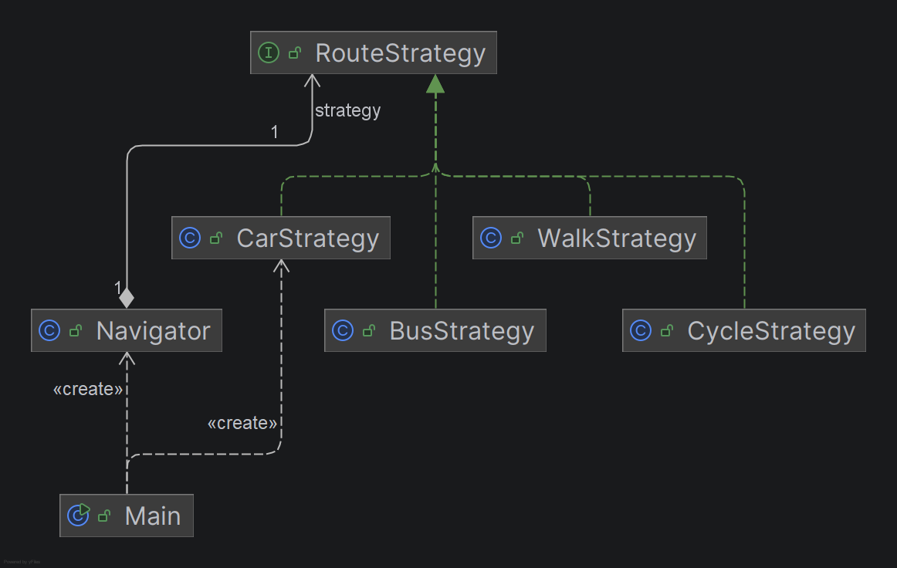

# Assignment #5 - Strategy Pattern

Course: ShP-2216 Software Design Patterns
Student: Nurzhaubai Dinara, Group: SE-2526

## 1. Introduction

I chose Option A: Navigation / Route Planning. The algorithm family is "build a route from point A to point B". Each travel mode (car, walk, cycle, bus) calculates the distance and the travel time in its own way, but all of them take the same input (two locations) and return the same output (a route). Because of this they are interchangeable algorithms, and the user can change the travel mode while the program is running.

## 2. UML class diagram



Navigator (Context) holds a reference to the RouteStrategy interface and delegates the work to it. Main (Client) creates the concrete strategy and passes it to Navigator through the constructor or setStrategy.

## 3. Clean Code section

### 3.1 Replace conditional logic with polymorphism

Before:
```java
Route plan(String mode, Location a, Location b) {
    if (mode.equals("car")) { ... }
    else if (mode.equals("walk")) { ... }
    else if (mode.equals("cycle")) { ... }
}
```
After:
```java
public Route planRoute(Location from, Location to) {
    return strategy.buildRoute(from, to);
}
```
Why: Navigator has no if/switch on the strategy type. Adding a new mode does not require editing this method.

### 3.2 Meaningful, intention-revealing names

Before:
```java
double k = 1.3;
int s = 50;
```
After:
```java
private static final double ROAD_FACTOR = 1.3;
private static final double SPEED_KMH = 50.0;
```
Why: class names (CarStrategy, WalkStrategy), the method buildRoute and the constants explain themselves, and there are no magic numbers.

### 3.3 Single Responsibility Principle

```java
public class WalkStrategy implements RouteStrategy {
    // only the walking algorithm, nothing else
}
```
Why: each strategy has exactly one reason to change, which is its own algorithm. A change in cycling rules cannot break walking.

### 3.4 Context is algorithm-agnostic

```java
public class Navigator {
    private RouteStrategy strategy;   // interface type, not a concrete class
}
```
Why: Navigator does not import or mention any concrete strategy. It depends on the abstraction (Dependency Inversion Principle).

### 3.5 Easy extensibility (Open/Closed Principle)

To add a new mode I create a new class that implements RouteStrategy and add one line to the map in Main:
```java
"bus", BusStrategy::new
```
Navigator, CarStrategy, WalkStrategy and CycleStrategy are not modified. BusStrategy was added to demonstrate this.

### 3.6 Fail fast and immutability (extra)

```java
this.strategy = Objects.requireNonNull(strategy, "strategy must not be null");
```
Location and Route are immutable records, so they cannot be changed after creation.

## 4. Strategy vs. State

My problem needs Strategy, not State. In Strategy the client chooses the algorithm from outside, the strategies do not know about each other, and the context changes its behavior only when the client calls setStrategy. In State the object changes its own state internally, usually as a reaction to events, and concrete states often decide which state comes next. In my navigator the user chooses the travel mode. A car route never turns into a walking route by itself, and there is no life cycle or transition graph. That is why it is a family of interchangeable algorithms, which is Strategy.

## 5. Conclusion

The Strategy pattern gave flexibility: new travel modes are added without touching existing code, there are no long if/else chains, and each algorithm can be tested separately. The cost is more classes: one interface plus one class per algorithm. For a growing family of algorithms this trade-off is worth it. For only two very simple variants a plain if statement would be simpler.

## 6. GitHub repository

https://github.com/Dinarra/SDP_5assignment

## References

- Freeman, E., & Robson, E. (2021). Head First Design Patterns (2nd ed.), Ch. 1.
- Martin, R. C. (2008). Clean Code, Ch. 10.
- refactoring.guru/design-patterns/strategy
- AI tools were used as a reference for examples and explanations.